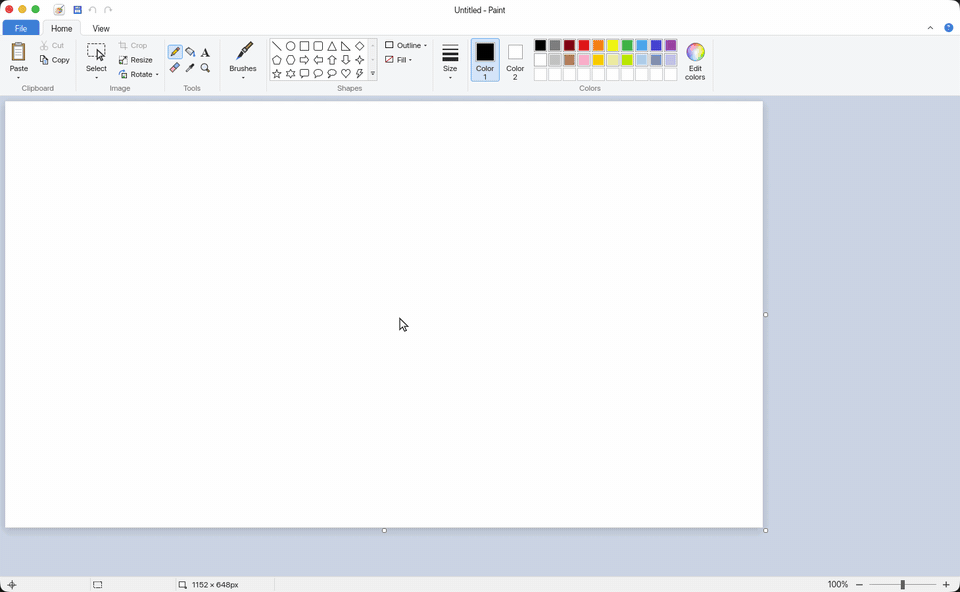
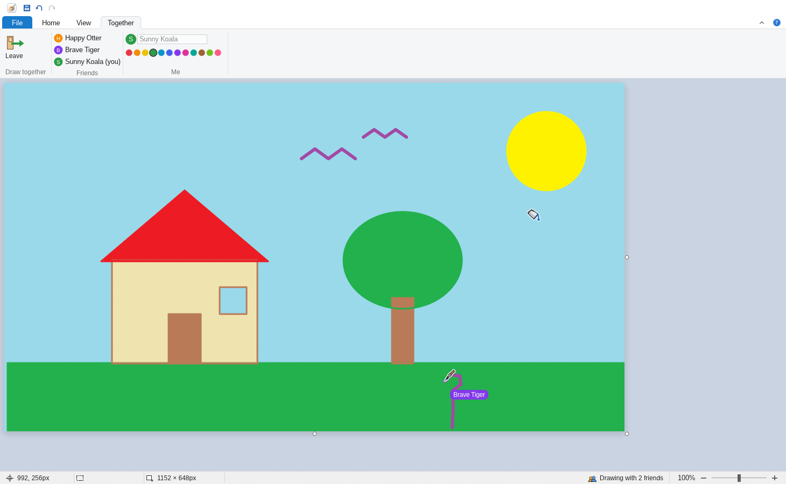
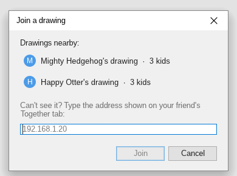
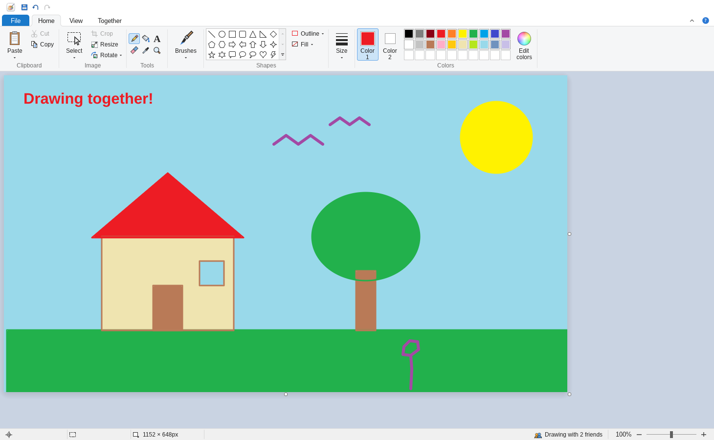
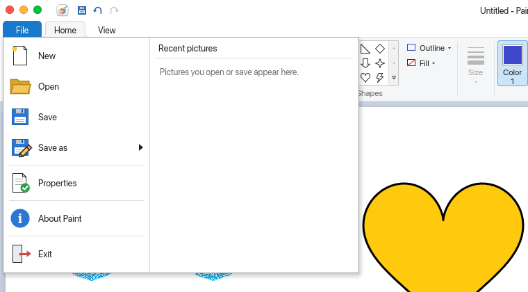
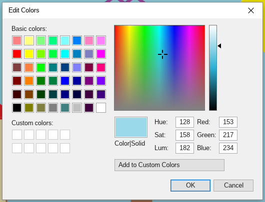
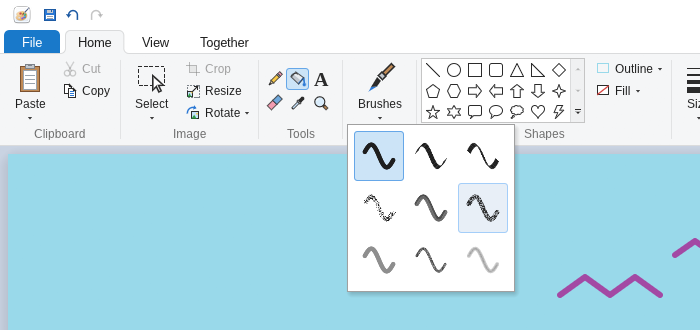
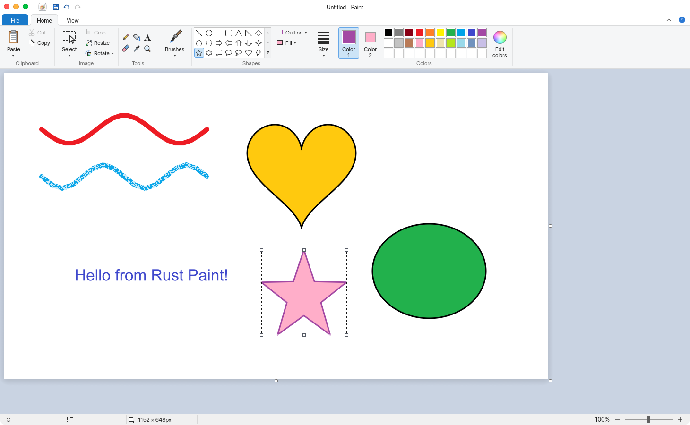
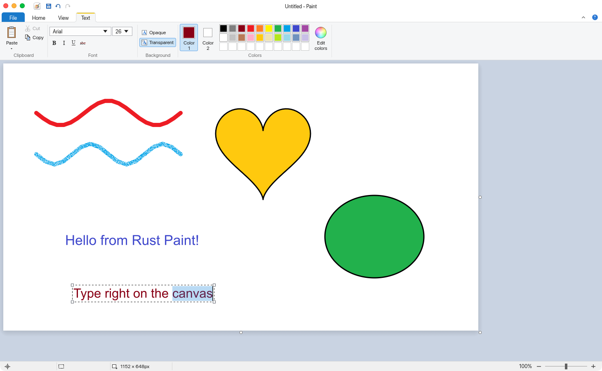
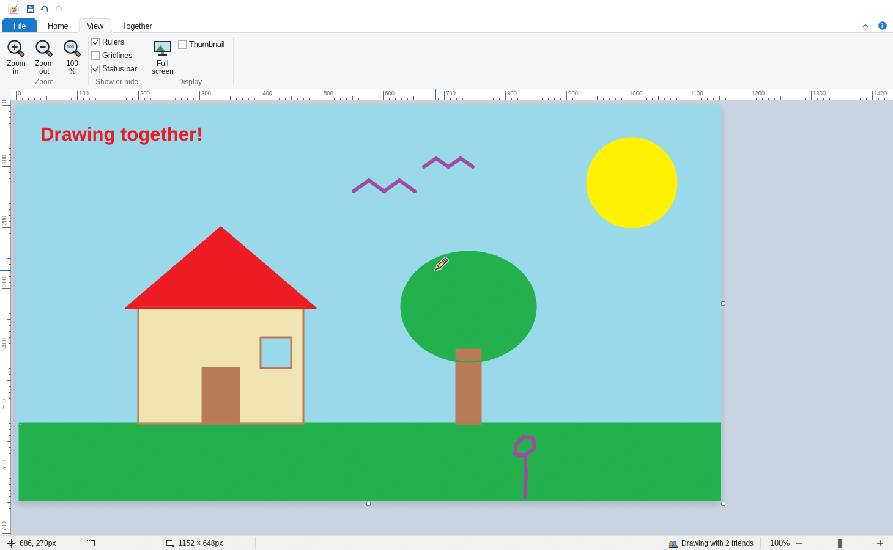

# Paint Together

**Classic Microsoft Paint, rebuilt in Rust, where kids on the same Wi-Fi draw on one picture together, live.** There's no server, no accounts and no internet: one kid starts a drawing, friends join it in a tap, and everyone sees each other's strokes and pointers as they draw.



Underneath is a from-scratch reimplementation of **classic Paint** (the Windows 7 / Windows 10 ribbon edition) for Linux, written in Rust with [egui](https://github.com/emilk/egui). It has the ribbon with its File menu and tabs, the tools and brushes, shapes you can move and resize after drawing, typing straight onto the canvas, the Windows color dialog, rulers and more. It runs natively on Wayland and X11.

```sh
cargo install paint-together     # then run: paint
```

> **Not affiliated with Microsoft.** "Microsoft", "Windows" and "Paint" are trademarks of Microsoft Corporation. This project contains no Microsoft code, icons or other assets: every icon is drawn in code, and the app icon is original.

---

## Contents

- [Drawing together](#drawing-together)
- [Install](#install)
- [Screenshots](#screenshots)
- [Features](#features)
- [Build from source](#build-from-source)
- [Using Paint](#using-paint)
- [Keyboard shortcuts](#keyboard-shortcuts)
- [How it works](#how-it-works)
- [Project layout](#project-layout)
- [Tests](#tests)
- [Limitations](#limitations)
- [License](#license)

---

## Drawing together



Everything happens on the **Together** tab.

1. One kid presses **Start drawing**. Their picture becomes the shared one. With **Let friends in without asking** on (the default), friends come straight in. Turn it off, and the host gets a small notice for each friend who wants to join, with a green tick to let them in and a red cross to say no.
2. Friends on the same Wi-Fi press **Join a drawing** and tap it in the list, or click *Join Maya's drawing* in the status bar. If it doesn't show up, type the address shown on the host's Together tab, such as `192.168.1.20`.
3. Everyone draws at once.



What you get:
- **See friends draw as they draw.** Strokes, shapes being dragged out, text being typed and selections being moved all show up live on everyone's screen. You also see each friend's pointer: their tool (the eraser shows as its square), with their name in their colour.
- **Every screen ends up identical.** The host's Paint puts every finished edit in one order and passes it on, and every app applies edits in that order. Edits travel as the pixels that changed, never as commands, so different computers, fonts or maths libraries can't make pictures drift apart.
- **Undo takes back only your own work.** Anything a friend drew over it since stays.
- **Anyone can change the whole picture** (New, Open, Rotate, Crop, Resize…). New and Open ask first, because they replace the picture on everyone's screen.
- **If the host leaves, the drawing carries on.** The next kid's Paint takes over as host, and everyone reconnects to it automatically, keeping their undo history and any edits still on their way.
- **Who's here.** The Friends list shows up to nine names, and a button opens the full list for a big room. The status bar says how many friends are drawing, and a short notice says who joined or left. When a crowd arrives, it's one notice, such as "12 friends joined".
- **The host keeps order.** Hovering a friend's name shows a cross that kicks them out, and everyone sees a notice such as "Blue Fox has been kicked out by Maya". The kicked-out kid keeps the picture, and has to ask to come back, even when friends are let in without asking.
- **Fun names** ("Mighty Hedgehog") and colours, which you can change on the Together tab.

From the command line, `paint --join 192.168.1.20` opens Paint and joins that drawing straight away.

**Network:** drawing together uses TCP port **47100** (or another free port) for the drawing, and mDNS (UDP port **5353**) to find drawings nearby. Both stay on the local network. If a firewall blocks them, friends can't find or join the drawing; with `ufw`, for example, run `sudo ufw allow 47100/tcp` and `sudo ufw allow 5353/udp`. On Windows, the firewall asks the first time you open the Together tab: choose **Allow access**. There is no join code: anyone on the same network can join a drawing they can see, unless the host lets friends in one by one.

---

## Install

**With Cargo** (any 64-bit Linux, on x86_64 or ARM64):

```sh
cargo install paint-together
paint
```

This builds Paint from [crates.io](https://crates.io/crates/paint-together) and installs the `paint` command into `~/.cargo/bin`. You'll need [Rust](https://rustup.rs) 1.85 or later; no GTK, Qt or other `-dev` packages are needed.

**Prebuilt (x86_64):** each [GitHub release](https://github.com/stephenkingston/paint-together/releases) has a `paint-<version>-linux-x86_64.tar.gz`. Drawing together arrived in version 0.2.0. Download it, then:

```sh
tar xzf paint-<version>-linux-x86_64.tar.gz
cd paint-<version>-linux-x86_64
./paint                 # run it from here, or
./install.sh            # install it for your user
```

Each release also has builds for Windows and macOS; its notes say how to open them.

`install.sh` doesn't need root. It copies the binary to `~/.local/bin/paint`, and adds the icon and a *Paint* entry to your app launcher. To uninstall, delete `~/.local/bin/paint`, `~/.local/share/applications/paint.desktop` and `~/.local/share/icons/hicolor/256x256/apps/paint.png`. To check a download: `sha256sum -c paint-<version>-linux-x86_64.tar.gz.sha256`.

### Requirements
- **Linux with glibc 2.35 or newer** for the prebuilt binary: Ubuntu 22.04, Debian 12, Fedora 36, Arch, or later.
- **Wayland or X11**, with working **Vulkan or OpenGL** drivers.
- **fontconfig**, which the Text tool uses to find fonts.
- An **XDG desktop portal** (`xdg-desktop-portal` plus a backend such as `-gtk`, `-kde`, `-gnome` or `-hyprland`) for the Open and Save dialogs. Desktop environments include one.

### If Paint won't start
If Paint can't open its window, or runs into a problem and has to close, it says so and saves the details in `crash.txt`: in `%APPDATA%\Paint (Rust)` on Windows, `~/Library/Application Support/Paint (Rust)` on macOS and `~/.config/paint-rust` on Linux. Please attach that file when reporting the problem.

On Windows, Paint draws with Direct3D 12, falling back to Windows' own software renderer when the graphics driver lacks it. To try the Vulkan or OpenGL driver instead, set the environment variable `WGPU_BACKEND` to `vulkan` or `gl`.

---

## Screenshots

**The main window**: Quick Access Toolbar, the File / Home / View / Together tabs, the Home ribbon, the canvas and the status bar.



| | |
|---|---|
| **File menu**: big-icon commands, plus *Recent pictures* (or, when you hover *Save as*, a list of formats).<br><br> | **Edit Colors**: modeled on the Windows color dialog: basic and custom colors, a hue/saturation spectrum, a luminance bar, and HSL/RGB fields.<br><br> |
| **Brushes**: nine brush types, each shown as a sample stroke.<br><br> | **Shapes stay editable**: after drawing, a shape keeps a dashed box with eight handles until you click away.<br><br> |

**Text is typed straight onto the canvas.** The contextual *Text* tab appears with the Text tool, and the caret and selection are drawn on the picture itself.



**View tab** with rulers, gridlines, status bar, full screen and thumbnail options.



---

## Features

### The ribbon, as in Paint
- **Quick Access Toolbar** above the tabs: Save, Undo, Redo.
- **File menu** with New, Open, Save, *Save as* (PNG, JPEG, BMP, GIF, or *Other formats*), Properties, About and Exit, plus *Recent pictures*, which are kept between launches.
- **Home**, **View**, **Together** and a contextual **Text** tab. You can collapse the ribbon to just the tabs.
- Large and small buttons, split buttons (Paste, Select, Brushes), dropdown galleries and grouped captions, all in the Windows 10 "Scenic Ribbon" style. The tabs and highlights have softly rounded corners.

### Drawing tools
- **Pencil**: hard-edged lines, 1–20 px.
- The mouse pointer turns into the tool itself for the Pencil, Fill, Brushes and Color picker, with the tip exactly where it works. The Eraser's pointer is just its square, in Color 2.
- **Brushes**: nine types: Brush, Calligraphy 1 and 2, Airbrush (keeps spraying while you hold still), Oil, Crayon, Marker (translucent), Natural pencil and Watercolor.
- **Fill with color**: flood fill with adjustable tolerance. It also reaches into the smoothed edges of outlines, so no pale ring is left between the fill and the outline.
- **Eraser**: paints Color 2.
- **Color picker** and **Magnifier**: left-click zooms in, right-click zooms out.
- The left mouse button draws with **Color 1** and the right button with **Color 2**, as in Paint.

### Shapes
- **21 shapes**: line, oval, rectangle, rounded rectangle, triangle, right triangle, diamond, pentagon, hexagon, four arrows, 4/5/6-point stars, rounded-rectangle, oval and cloud callouts, heart and lightning.
- **Outline** (Color 1) and **Fill** (Color 2), each solid or off. The ribbon icons show the current colors, with a red slash for "none".
- **Shapes stay live after drawing.** You can:
  - drag inside the box to move the shape;
  - drag any of its eight handles to resize it (it's redrawn, not stretched, so it stays sharp);
  - change colors, size, outline or fill from the ribbon, and the shape updates in place.

  Click away, pick another shape or switch tools to stamp the shape onto the picture.
- **Shift** keeps shapes in proportion (squares, circles) and snaps lines to 45°.

### Text
- **Type directly on the canvas**: no pop-up field, with a blinking caret and a highlighted selection.
- Full keyboard editing: arrows (Ctrl by word), Home/End, Shift to select, Ctrl+A, Backspace and Delete (Ctrl for a whole word), Enter for new lines, Ctrl+C / Ctrl+X / Ctrl+V, and undo/redo while typing.
- **Input methods** work, for example for Chinese, Japanese or Korean input.
- **Click** inside the text to put the caret there. **Drag** to move the text, and drag a **corner handle** to scale it.
- Any installed font, with sizes from 8 to 72 pt, **Bold**, *Italic*, Underline and ~~Strikethrough~~, on an *Opaque* or *Transparent* background.

### Selections and the clipboard
- **Rectangular** and **free-form** selection, select all, delete, and **Transparent selection** (Color 2 becomes see-through).
- Move selections by dragging or with the arrow keys. Cut, copy and paste work with other apps, including images (for example screenshots). *Paste from* inserts a picture file.
- **Crop**, **Resize and Skew** (by percentage or pixels, keeping the aspect ratio), **Rotate** 90° / 180°, **Flip** horizontally or vertically, and **Invert colors**. These apply to the selection if there is one, otherwise to the whole picture.
- Right-click a selection for Paint's context menu.

### Colors
- **Color 1 / Color 2** buttons, Paint's 20-color palette (hover a swatch for its name), and ten custom color slots.
- The **Edit Colors** dialog, modeled on the Windows color dialog: a hue × saturation spectrum, a luminance bar, Hue/Sat/Lum on Windows' 0–240 scale, and Red/Green/Blue fields.

### Viewing
- Zoom with Ctrl + scroll, the status-bar slider, presets or the Magnifier. Zoom stays centered on the pointer.
- **Rulers** with a marker following the cursor, **gridlines** at any zoom (one per pixel from 400% up), **full screen**, and a **thumbnail** window.
- Resize the canvas by dragging its handles, or type an exact size in **Image Properties**. New space is filled with Color 2.
- Middle-drag to pan.

### Files
- Opens PNG, JPEG, BMP, GIF, TIFF, WebP and ICO. Saves PNG, JPEG, BMP, GIF, TIFF and WebP.
- You can also pass a picture on the command line, or drag one onto the window (on X11).
- Asks before throwing away unsaved changes (on New, Open and Quit).
- Unlimited undo/redo within a 256 MB memory budget. Each step stores only the pixels it changed.

### Native on Linux
- Runs on **Wayland** and **X11**, scales on HiDPI screens, uses your system fonts (found through fontconfig), and opens your desktop's own Open/Save dialogs through the XDG desktop portal.
- A self-contained binary with an app-launcher entry and icon; it doesn't depend on GTK or Qt.

---

## Build from source

You'll need **Rust 1.85** or later (the project uses the 2024 edition); install it with [rustup](https://rustup.rs). No GTK, Qt or other `-dev` packages are needed.

```sh
git clone https://github.com/stephenkingston/paint-together.git
cd paint-together
cargo run --release              # or: cargo install --path .
```

To open a picture straight away:

```sh
cargo run --release -- ~/Pictures/photo.png
```

### Releases

Pushing a version tag (`git tag v0.2.0 && git push origin v0.2.0`) runs [`.github/workflows/release.yml`](.github/workflows/release.yml). It runs the tests, builds on Ubuntu 22.04 (so the binary also runs on older distributions), and publishes a release with the packaged binary and its checksum.

---

## Using Paint

| Mouse | Action |
|---|---|
| Left drag | Draw with **Color 1** |
| Right drag | Draw with **Color 2** |
| Middle drag | Pan the view |
| Ctrl + scroll | Zoom around the pointer |
| Drag a canvas handle | Resize the canvas |
| Drag inside a live shape or text box | Move it |
| Drag a shape's or text box's handle | Resize the shape / scale the text |
| Right-click with a selection tool | Context menu |
| Click a palette color | Set the active color (Color 1 or 2, whichever is selected) |
| Right-click a palette color | Set Color 2 |

---

## Keyboard shortcuts

| Shortcut | Action |
|---|---|
| Ctrl+N / Ctrl+O / Ctrl+S / Ctrl+Shift+S | New / Open / Save / Save as |
| Ctrl+Z / Ctrl+Shift+Z (or Ctrl+Y) | Undo / Redo |
| Ctrl+X / Ctrl+C / Ctrl+V | Cut / Copy / Paste (images and text) |
| Ctrl+A | Select all |
| Ctrl+Shift+X | Crop to the selection |
| Ctrl+W | Resize and Skew |
| Ctrl+Shift+I | Invert colors |
| Ctrl+Shift+N | Clear the image |
| Ctrl+E | Image Properties |
| Ctrl++ / Ctrl+− | Zoom the picture in / out |
| Ctrl+1 / Ctrl+0 | Actual size / Fit to window |
| Ctrl+R / Ctrl+G | Toggle rulers / gridlines |
| F11 | Full screen (Esc or a click to leave) |
| Delete / Backspace | Delete the selection, live shape or text box |
| Arrow keys | Nudge the selection, live shape or placed text by 1 px |
| Enter / Esc | Stamp the live shape or text onto the picture. While typing, Esc only stops typing |
| Shift while drawing a shape | Keep proportions / snap lines to 45° |

---

## How it works

Paint is a single egui application. Some details worth knowing:

- **Drawing through coverage masks.** Tools don't paint straight onto the picture. Each stroke or shape is drawn as a coverage mask (how much of each pixel it covers, from 0 to 1), keeping the highest value per pixel. The mask is then composited over a snapshot taken when the operation began. This gives smooth, anti-aliased strokes without dark beads where they overlap, and lets shapes be redrawn from scratch on every mouse move.
- **Shapes and text stay live.** A live shape or text box remembers what was underneath it. Every move, resize or style change restores that area and redraws the object, until it is committed as a single undo step.
- **Flood fill that respects anti-aliasing.** After the normal fill, a second pass walks outward through the outline's smoothed edge pixels. It measures how much of each pixel is old background and how much is outline color, and redraws it as the same blend of the new color and the outline. It only moves toward the outline, so it can't leak past it.
- **Undo** stores the before and after pixels of just the rectangle each edit touched. Whole-image snapshots are used only when the canvas size changes.
- **Icons are code.** Every ribbon icon is drawn as vectors on a 20×20 grid, so one design serves both 16 px and 32 px buttons. Straight edges are aligned to whole pixels so they stay sharp. The shape-gallery icons, the color wheel and the app icon are drawn with the canvas's own rasterizer and cached as textures.
- **Text** is laid out and rasterized with [`ab_glyph`](https://crates.io/crates/ab_glyph) using your installed fonts, which it finds through fontconfig. Caret positions come from the same layout, so the caret lines up exactly with the drawn text.
- **Drawing together without a server.** The host kid's Paint runs a small hub on a background thread. The hub numbers every finished edit and sends it to everyone, including the kid who made it.
  - **Edits are pixels.** Each edit is a *masked pixel patch*: the changed pixels in a rectangle, plus a bit mask so untouched pixels are left alone. Patches are deflate-compressed and checked against size limits before use.
  - **Three pictures per app.** Each app keeps the *confirmed* picture (every numbered edit, in order), a *base* (confirmed plus my edits still on their way to the hub), and the picture on screen (base plus whatever I'm in the middle of).
  - **Rebasing.** When a friend's edit arrives, it goes into the base, and anything in progress (a stroke, live shape, text box or floating selection) is redrawn on top from its snapshot. That is the same order the hub gives everyone, so all screens end up identical.
  - **Previews and undo.** Live previews are the 64×64 tiles where the screen differs from the base, sent up to 30 times a second. Undo sends a patch that restores my pixels only where the picture still shows them.
  - **Finding and handing over.** mDNS finds drawings nearby, and heartbeats notice a vanished computer within seconds. Every guest keeps a port ready, so the earliest-joined kid can take over as host.
  - **The door.** Friends waiting to be let in hear nothing of the drawing until the host says yes. A new host carries on the room's choice, and lets everyone who was already in straight back in.

---

## Project layout

| File | What's in it |
|---|---|
| `src/main.rs` | Entry point and window setup; `--join ADDRESS`, and `--export-icon PATH [SIZE]` (used for packaging) |
| `src/crash.rs` | Saying so when Paint can't start or has to close, and keeping a crash report |
| `src/app.rs` | The app: state, tools, mouse and keyboard handling, ribbon tabs, menus, dialogs, canvas view |
| `src/ribbon.rs` | Ribbon controls: big, small and split buttons, groups, tabs, menu rows, swatches, sliders |
| `src/icons.rs` | Vector icons and their pixel-snapping drawing helpers |
| `src/theme.rs` | Colors, fonts and egui style for the classic Windows look |
| `src/raster.rs` | Pixel engine: coverage masks, capsules, polygon fill, compositing, flood fill |
| `src/brush.rs` | The nine brush types |
| `src/shapes.rs` | Geometry of the 21 shapes |
| `src/live_shape.rs` | Editable shapes: handles, hit-testing, re-rendering |
| `src/text.rs` | Font discovery, text layout, glyph rasterization, caret geometry |
| `src/text_edit.rs` | Caret, selection, word/line movement and undo for on-canvas typing |
| `src/history.rs` | Undo/redo |
| `src/logo.rs` | The app icon, rendered in code |
| `src/collab/mod.rs` | Drawing together: the confirmed / base / screen pictures, previews, friends' pointers |
| `src/collab/patch.rs` | Masked pixel patches, and undoing only your own pixels |
| `src/collab/hub.rs` | The host's coordinator: puts edits in order, keeps the true picture, and keeps the door (letting friends in, kicking out) |
| `src/collab/net.rs` | Framing, compression, the hub thread, connections and heartbeats |
| `src/collab/protocol.rs` | The messages apps send each other |
| `src/collab/discovery.rs` | Finding drawings nearby with mDNS |
| `src/collab/names.rs` | Fun names and colours |
| `src/tests.rs` | Pixel-engine tests (app-level tests live at the bottom of `app.rs`) |
| `packaging/linux/` | The launcher entry (`paint.desktop`) and `install.sh`, shipped in the release |
| `packaging/release-notes.md` | Notes published with each release |
| `.github/workflows/release.yml` | Tests, builds and publishes a release when a version tag is pushed |

---

## Tests

```sh
cargo test
```

The suite of 67 tests (68 on Windows) covers:
- **Pixel engine:** polygon coverage, anti-aliased capsules, flood fill boundaries, tolerance, and fills that reach anti-aliased edges without leaking.
- **Undo history.**
- **Shapes and brushes:** the geometry of every shape, and every brush.
- **Tools, driven as the mouse drives them:** strokes with either mouse button, the eraser, shape outline and fill, live shapes (moving, resizing, restyling, deleting, stamping when another shape is picked), selections (moving, free-form delete, transparent selection, rotating a selection), and pasting an image larger than the canvas.
- **Text:** rendering, and on-canvas typing using real keyboard events (caret movement, word selection, undo, input-method text, paste, click-to-place-caret). On Windows, naming every installed font from a few small tables finds the same faces as reading the whole files.
- **Zoom** stays centered on the pointer, and its keys zoom only the picture. **Gridlines** are spaced for every zoom level. Pencil, Fill, Brushes and Color picker use their own pointer, and the Eraser shows only its square.
- **Drawing together:**
  - **Simulated rooms.** Several Paints share one hub, and the tests decide exactly when every message arrives. Directed tests cover:
    - a friend's stroke arriving while I'm mid-stroke;
    - edits crossing on the network;
    - drawing under my text box and under a selection I'm moving;
    - a friend rotating the picture mid-stroke;
    - undo leaving friends' pixels alone;
    - previews, pointers and friends' tools;
    - join and leave notices (a crowd arriving is one notice);
    - the host kicking a friend out, and friends waiting until the host lets them in (or doesn't);
    - friends' drawings in progress merged into the picture on screen, which keeps its transparency.
  - **Random sessions.** Randomized sessions of strokes, fills, shapes, text, moved selections, undo, redo and whole-picture changes, with messages arriving in random orders. Every screen must end up identical, byte for byte, with no friend's unfinished drawing left behind.
  - **The door.** Kicked-out kids have to ask to come back, only the host decides, and after a takeover everyone who was in comes straight back.
  - **Real sockets.** Message framing and size limits, a host and a friend talking over real sockets, a quiet friend staying connected while another chats, a friend waiting at the door (hearing nothing of the drawing) until let in and cut off when kicked out, and a host leaving while the next kid takes over.

One more test is run by hand across two computers: start a drawing on one, then on the other run `PAINT_JOIN=<address> cargo test joins_a_real_room -- --ignored --nocapture`.

---

## Limitations

- **Missing from classic Paint:** the *Curve* and *Polygon* shapes, the special outline styles (crayon, marker…), printing, and *Invert selection*.
- **Paint 11** (the Windows 11 version) adds layers and AI tools; those aren't included either.
- **Prebuilt for x86_64 only.** On ARM64, build from source.
- **Ctrl+V doesn't paste an image** when the clipboard holds only an image (no text), because the windowing layer swallows the keystroke. Use **Paste** on the ribbon or the right-click menu instead.
- **Dropping files onto the window** works on X11 but not yet on Wayland. Use **Open**, or pass the file on the command line.
- Without an XDG desktop portal, the Open and Save dialogs can't appear.
- **Drawing together** works only on a local network. Some school or guest Wi-Fi networks keep devices apart; then nobody can join, even by address. When multicast is blocked, drawings don't show up in the list, but you can still join by typing the address.
- If the host's computer crashes mid-stroke, the last moment of drawing that hadn't reached everyone may be lost when the next kid takes over.

---

## License

Released under the [MIT License](LICENSE). © 2026 Stephen Kingston.

Built with [egui/eframe](https://github.com/emilk/egui), [image](https://github.com/image-rs/image), [ab_glyph](https://github.com/alexheretic/ab-glyph), [rfd](https://github.com/PolyMeilleur/rfd), [arboard](https://github.com/1Password/arboard), [mdns-sd](https://github.com/keepsimple1/mdns-sd), [bincode](https://github.com/bincode-org/bincode) and [flate2](https://github.com/rust-lang/flate2-rs).
